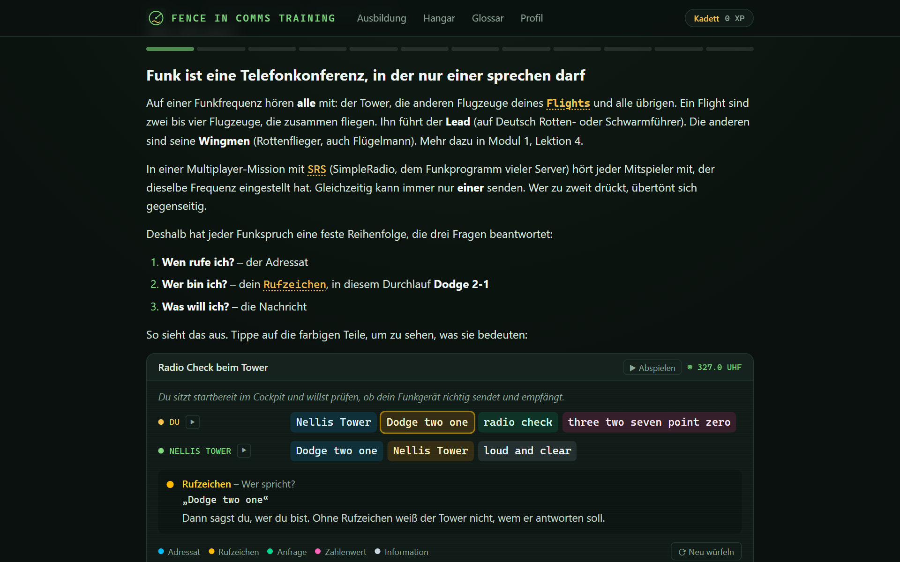
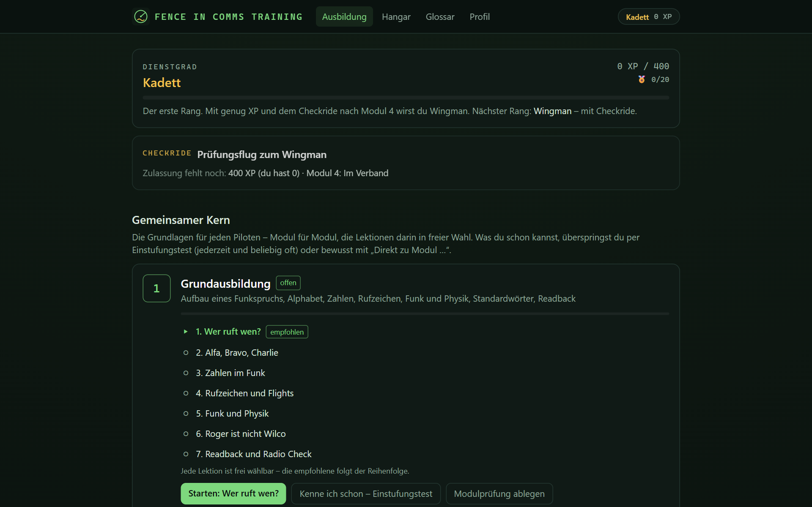
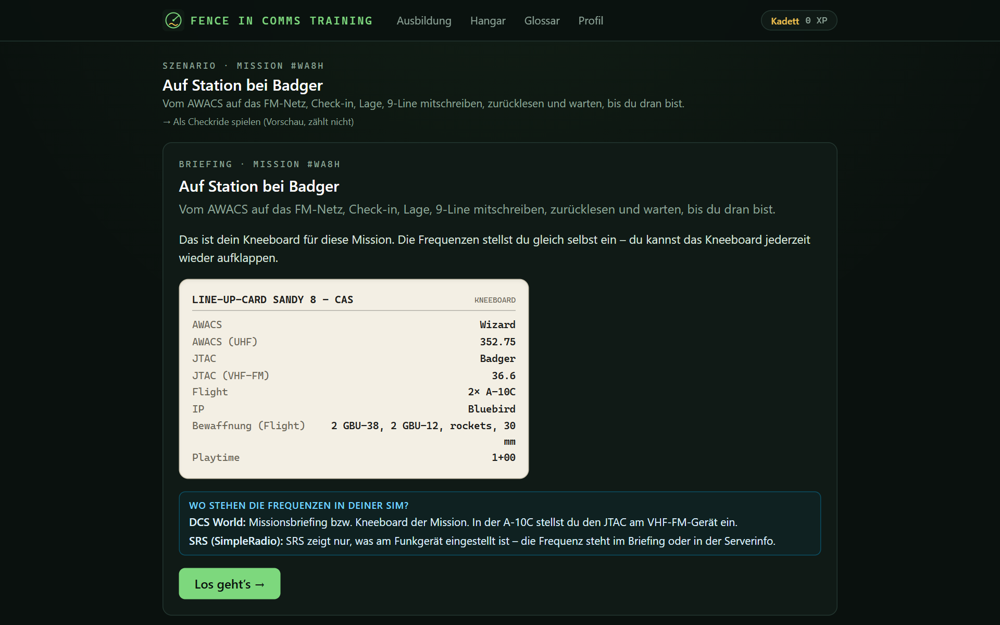

# Fence In Comms Training

*[English](README.md) · Deutsch*

**Lern-App für militärischen Flugfunk für Flugsim-Piloten** – für DCS World, Falcon BMS, IL-2 Sturmovik und alle,
die mit SimpleRadio (SRS) auf Multiplayer-Servern fliegen. Die Oberfläche ist auf Deutsch, die Funksprüche
bleiben im englischen Original.

*„Fence in“* funkt ein Flight, kurz bevor er ins Einsatzgebiet einfliegt: Schalter gesetzt, bereit. Diese App ist
der Schritt davor – damit du auf einem Server voller echter Menschen klingst, als gehörtest du dazu.



## Was die App kann

- **Jeder Funkspruch zerlegt.** Jede Meldung wird in ihre Teile zerlegt – wen du rufst, wer du bist, was du
  willst – und jeder Teil wird erklärt. Tipp auf einen Teil, um zu sehen, wofür er da ist.
- **Theorie und Praxis im Wechsel.** Kurze Lektionen, Übungen, Einstufungstests, Modulprüfungen und Checkrides
  für den nächsten Dienstgrad.
- **Nie zweimal dieselbe Mission.** Rufzeichen, Flugplätze, Pisten, Frequenzen, Zahlen und 9-Lines werden jedes
  Mal neu gewürfelt.
- **Szenarien mit Kneeboard.** Du bekommst die Line-up-Card, stellst die Frequenzen selbst ein, checkst ein, liest
  zurück und wartest, bis du dran bist.
- **Sprechen oder tippen.** Spracherkennung (whisper.cpp) und Funkstimmen für die Gegenstellen (Kokoro-82M, mit
  AM-, FM- und Intercom-Klang) laufen auf Wunsch komplett auf deinem eigenen Rechner.
- **Für alle Sims.** Erst die offizielle Phraseologie, dann die Praxis der Community, dann die Besonderheiten der
  einzelnen Sims (DCS, BMS, IL-2, SRS) – gefiltert nach den Sims und Flugzeugen in deinem Profil.
- **Hangar und Glossar.** 59 Hintergrundkarten zu Geschichte, Technik und Physik, dazu über 200 Brevity-Codes,
  Standardwörter und das Funkalphabet.

<p>
  
  
</p>

### Lehrplan

| | Themen | Stand |
|---|---|---|
| Modul 1 – Grundausbildung | Aufbau eines Funkspruchs, Alphabet, Zahlen, Rufzeichen, Funk und Physik, Standardwörter, Readback | verfügbar |
| Modul 2 – Funkgeräte & Comm Plan | UHF/VHF/FM, Presets, „push“, Guard, Funkdisziplin, SRS, Karten und Frequenzquellen | verfügbar |
| Modul 3 – Am Boden & Bodencrew | Crew Chief, ATIS, Startup, Taxi, Arming, Tower, Departure | verfügbar |
| Modul 4 – Im Verband | Lead und Wingman, Fence in/out, Ops Check, Joker/Bingo, lost wingman, NORDO | verfügbar |
| Modul 5 – AWACS-Grundlagen | Check-in, Bullseye, BRAA und Bogey Dope, Picture, Declare, CAP-Station | verfügbar |
| Spur C – Mud Moving / CAS | JTAC-Check-in, 9-Line, Talk-on, In/Off, Cleared Hot | verfügbar |
| Spur W – Warbirds & Kalter Krieg | Kanäle statt Presets, IL-2 ohne Funkgerät, Leitstelle statt AWACS | verfügbar |
| Später | Air Force Ops, Navy und Träger, Crew-Intercom, Luftkampf, Gesamtmissionen, BMS Korea | geplant |

## Installation (Windows)

1. `Fence In Comms Training_<Version>_x64-setup.exe` von den
   [Releases](https://github.com/carelesstuna/fence-in-comms-training/releases) herunterladen.
2. Optional: die Prüfsumme mit `SHA256SUMS.txt` vergleichen (PowerShell: `Get-FileHash <Datei>`).
3. Installer starten. Er installiert nur für deinen Benutzer und braucht keine Administratorrechte. Der Installer
   ist nicht signiert; warnt Windows SmartScreen, „Weitere Informationen → Trotzdem ausführen“.

**Voraussetzungen:** Windows 10 oder 11, 64 Bit. Fehlt WebView2, installiert der Installer es nach. Optional lädt
die App auf Klick nach: ein Spracherkennungsmodell (small.en, rund 190 MB; andere Größen wählbar) und die
Funkstimmen (rund 340 MB). Mit einer Vulkan-fähigen Grafikkarte erkennt die App einen Funkspruch in etwa einer
Sekunde, auf der CPU dauert es einige Sekunden.

**Datenschutz:** kein Konto, keine Telemetrie, keine Werbung. Ins Internet geht die App nur, wenn du ein Modell
herunterladen willst (huggingface.co, raw.githubusercontent.com). Dein Fortschritt bleibt auf deinem Rechner; du
kannst ihn exportieren und importieren.

## Mit KI gebaut – auf den Schultern von Tausenden

Gleich vorweg: Fast alles in diesem Repository hat eine KI geschrieben (Claude von Anthropic) – der Code, die
47 Lektionen, die gut 500 Übungen, das Glossar, die Hangar-Geschichten, die Tests und, ja, auch dieses README.
Mein eigener Anteil: der Bedarf („Ich will auf SRS nicht mehr klingen wie ein Tourist“), viel Lenken und
Gegensteuern („Nein, so redet kein Wingman“), Testen – und deutlich öfter die Sprechtaste drücken als jeder echte
Pilot. Ich bin hier also weniger Autor als ein Flight Lead, dessen Wortschatz vor allem aus „push two“,
„fence in“ und gelegentlich „say again?“ besteht.

Die KI konnte das wiederum nur, weil Tausende sehr kluge Menschen Millionen Stunden harter Arbeit investiert
haben, lange bevor jemand sie danach gefragt hat: Pilotinnen und Piloten, Fluglotsen, JTACs und Fluglehrer, die
aufgeschrieben haben, wie Funk wirklich funktioniert; die Autoren von FAA-, ICAO- und Militärvorschriften; die
Entwickler von DCS World, Falcon BMS, IL-2 und ihren Modulen, die Funkgeräte und Handbücher in erstaunlicher
Tiefe gebaut haben; die Communities mit ihren Wikis, SOPs, Serverbriefings, Comm Cards und endlosen
Forenthreads; die Menschen hinter SimpleRadio, whisper.cpp, Kokoro, ONNX Runtime, Tauri, React und Hunderten
weiteren Open-Source-Projekten – und alle, von deren Texten das Modell überhaupt erst gelernt hat. Was hier gut
ist, gehört ihnen. Was hier falsch ist, geht auf unsere Kappe: bitte ein Issue aufmachen. Die KI entschuldigt
sich dann ausführlich (das kann sie wirklich gut) und korrigiert es.

## Stand und Rückmeldung

Version 0.1 – die erste öffentliche Fassung. Fehler, falsche Phraseologie, Ideen: bitte ein
[Issue](https://github.com/carelesstuna/fence-in-comms-training/issues) aufmachen. Korrekturen von echten
Pilotinnen und Piloten, Lotsen, JTACs und erfahrenen Simmern sind besonders willkommen. Wie du beitragen kannst:
[CONTRIBUTING.md](CONTRIBUTING.md) (auf Englisch).

## Entwicklung

```bash
npm install
npm run dev        # App lokal im Browser starten
npm run validate   # alle Inhalte prüfen
npm test           # Unit-Tests
```

- Desktop-App (Tauri) bauen: [docs/desktop-app.md](docs/desktop-app.md)
- Spracherkennung: [docs/spracherkennung.md](docs/spracherkennung.md), Funkstimmen: [docs/audio.md](docs/audio.md)
- Inhaltsformat (Lektionen, Funksprüche, Übungen): [content/README.md](content/README.md)

Planungs- und Recherchenotizen gehören nicht zum öffentlichen Repository; Verweise darauf in Code-Kommentaren
laufen deshalb ins Leere.

## Lizenz

- Programmcode: MIT, siehe [LICENSE](LICENSE)
- Lerninhalte in `content/`: CC BY-SA 4.0, siehe [LICENSE-CONTENT.md](LICENSE-CONTENT.md) (dort auch die
  Namensnennung für Material aus Wikipedia)
- Bausteine Dritter: unter ihren eigenen Lizenzen. Die vollständige Liste mit allen Lizenztexten entsteht beim
  Build (`LICENSES.txt`, in der App unter Profil → Lizenzen). Texte für Pakete ohne eigene Lizenzdatei liegen in
  [third-party-licenses/](third-party-licenses/).

## Rechtliches

Unabhängiges, nicht kommerzielles Hobbyprojekt – nur für das Training in Flugsimulationen, keine offizielle Quelle
und nicht für die reale Luftfahrt. Genannte Spiele, Programme, Organisationen und Flugzeugmuster können Marken
ihrer Inhaber sein; sie werden nur zur Beschreibung genannt, eine Verbindung zu ihnen besteht nicht. Code und
Inhalte gibt es unentgeltlich und ohne Gewähr; die Haftung für Vorsatz, grobe Fahrlässigkeit und nach zwingenden
gesetzlichen Vorschriften bleibt unberührt. Ausführlich (auf Englisch): [LEGAL.md](LEGAL.md).
