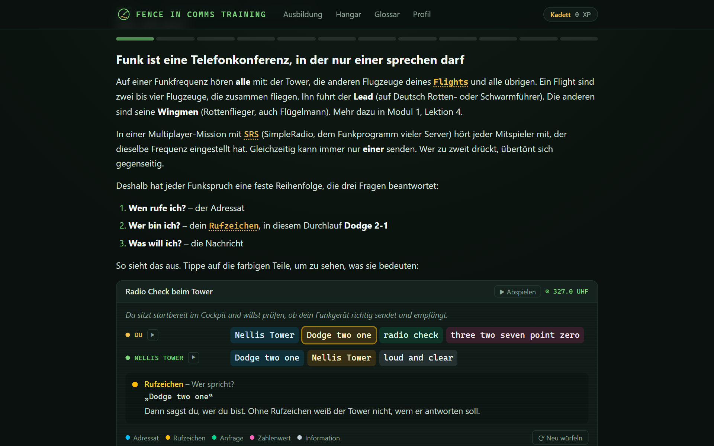
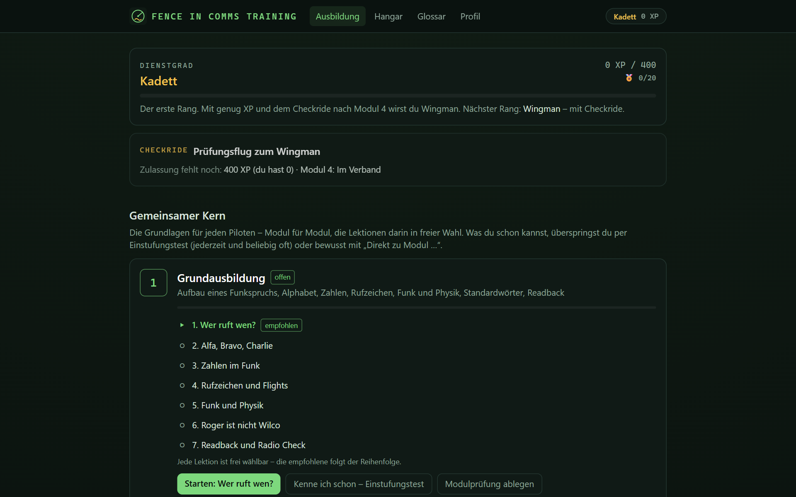
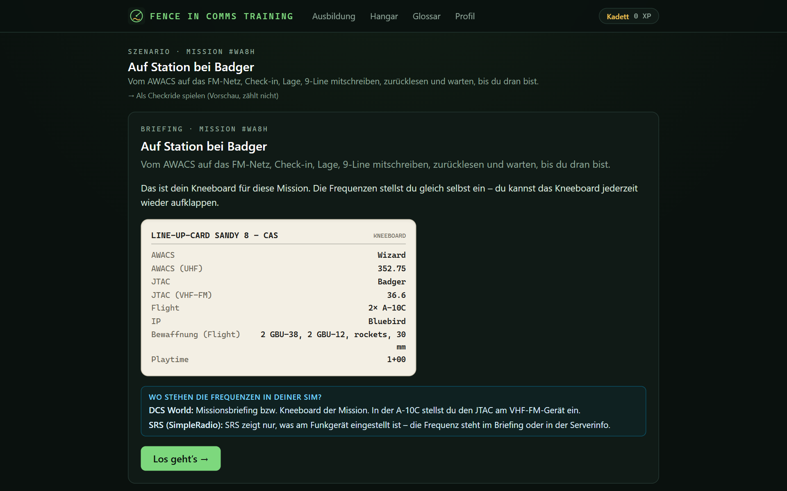

# Fence In Comms Training

*English · [Deutsch](README.de.md)*

**Military aviation radio training for flight-sim pilots** – for DCS World, Falcon BMS, IL-2 Sturmovik and
anyone who flies with SimpleRadio (SRS) on a multiplayer server.

*"Fence in"* is the call a flight makes right before it enters the operating area: switches set, ready. This app
is the step before that call – so that when you key the mic on a server full of real people, you sound like you
belong there.

> **Language:** The app is currently in **German** (explanations and menus). Radio calls stay in their original
> **English** phraseology. More languages are planned.



## What it does

- **Every call, dissected.** Each transmission is split into its parts – who is called, who is calling, what is
  wanted – and every part is explained. Tap a segment to see why it is there.
- **Theory and practice, alternating.** Short lessons, drills, placement tests, module exams and checkrides
  for the next rank.
- **Never the same mission twice.** Callsigns, airfields, runways, frequencies, numbers and 9-lines are rolled
  fresh every time.
- **Scenarios with a kneeboard.** You get the line-up card, dial in the frequencies yourself and work through
  check-in, readbacks and waiting for your turn.
- **Speak or type.** Optional speech recognition (whisper.cpp) and radio voices for the other stations
  (Kokoro-82M, with AM, FM and intercom sound) run entirely on your own PC.
- **Sim-agnostic.** Official phraseology first, then community practice, then the details of each sim (DCS, BMS,
  IL-2, SRS) – filtered by the sims and aircraft in your profile.
- **Hangar and glossary.** 59 background cards on history, technology and physics, plus more than 200 brevity
  codes, prowords and the phonetic alphabet.

<p>
  
  
</p>

### Curriculum

| | Topics | Status |
|---|---|---|
| Module 1 – Basics | Structure of a call, alphabet, numbers, callsigns, radio physics, prowords, readback | available |
| Module 2 – Radios & comm plan | UHF/VHF/FM, presets, "push", guard, radio discipline, SRS, charts and frequency sources | available |
| Module 3 – On the ground | Crew chief, ATIS, start-up, taxi, arming, tower, departure | available |
| Module 4 – Formation | Lead and wingman, fence in/out, ops check, joker/bingo, lost wingman, NORDO | available |
| Module 5 – AWACS basics | Check-in, bullseye, BRAA and bogey dope, picture, declare, CAP station | available |
| Track C – Mud moving / CAS | JTAC check-in, 9-line, talk-on, in/off, cleared hot | available |
| Track W – Warbirds & Cold War | Channels instead of presets, IL-2 without a radio, GCI instead of AWACS | available |
| Coming later | Air Force ops, Navy and carrier, crew intercom, air combat, full missions, BMS Korea | planned |

## Installation (Windows)

1. Download `Fence-In-Comms-Training_<version>_x64-setup.exe` from
   [Releases](https://github.com/carelesstuna/fence-in-comms-training/releases).
2. Optional: compare the checksum with `SHA256SUMS.txt` (PowerShell: `Get-FileHash <file>`). Installers are
   built by GitHub Actions from the public source; `gh attestation verify <file> --repo
   carelesstuna/fence-in-comms-training` proves where a file came from.
3. Run the installer. It installs for your user only and needs no admin rights. The installer is not
   code-signed, so Windows SmartScreen may warn you: *More info → Run anyway*.

**Requirements:** Windows 10 or 11, 64-bit. WebView2 is installed automatically if it is missing. Optional
downloads inside the app, offered on first start and later under Profil: a speech recognition model (small.en,
about 190 MB; other sizes available) and the radio voices (about 340 MB). A Vulkan-capable graphics card makes
speech recognition fast (about one second per call); on the CPU it takes a few seconds.

**Privacy:** no account, no telemetry, no ads. The app only goes online when you click to download a model
(huggingface.co, raw.githubusercontent.com). Your progress stays on your PC; you can export and import it.

## Built by AI – standing on the shoulders of thousands

Let's be honest up front: almost everything in this repository was written by an AI (Claude by Anthropic) – the
code, the 47 lessons, the 500-odd drills, the glossary, the hangar stories, the tests and, yes, this README too.
My own contribution: the need ("I want to stop sounding like a tourist on SRS"), a lot of guiding and steering
("no, a wingman would never say that"), testing – and pressing the push-to-talk key far more often than any real
pilot ever would. So think of me less as the author and more as a flight lead whose vocabulary is mostly
"push two", "fence in" and the occasional "say again?".

The AI, in turn, could only do this because thousands of very clever people put in millions of hours of hard work
long before anyone asked it to: pilots, air traffic controllers, JTACs and instructors who wrote down how radio
really works; the authors of FAA, ICAO and military publications; the developers of DCS World, Falcon BMS, IL-2
and their modules, who built radios and manuals in astonishing detail; the communities with their wikis, SOPs,
server briefings, comm cards and endless forum threads; the people behind SimpleRadio, whisper.cpp, Kokoro,
ONNX Runtime, Tauri, React and hundreds of other open-source projects – and everyone whose writing the model
learned from in the first place. If something in here is good, it is theirs. If something is wrong, it is ours:
please open an issue. The AI will apologise profusely (it is really good at that) and fix it.

## Status and feedback

Version 0.2 – early public release. Bugs, wrong phraseology, ideas: please open an
[issue](https://github.com/carelesstuna/fence-in-comms-training/issues). Corrections from real-world pilots,
controllers, JTACs and veteran simmers are especially welcome. How to contribute: [CONTRIBUTING.md](CONTRIBUTING.md).

## Development

```bash
npm install
npm run dev        # run the app in the browser
npm run validate   # check all content files
npm test           # unit tests
```

- Building the desktop app (Tauri): [docs/desktop-app.md](docs/desktop-app.md)
- Speech recognition: [docs/spracherkennung.md](docs/spracherkennung.md), radio voices: [docs/audio.md](docs/audio.md)
- Content format (lessons, calls, drills): [content/README.md](content/README.md)

The documentation is in German. Planning and research notes are not part of the public repository, so
references to them in code comments lead nowhere.

## License

- Code: MIT, see [LICENSE](LICENSE)
- Learning content in `content/`: CC BY-SA 4.0, see [LICENSE-CONTENT.md](LICENSE-CONTENT.md) (including the
  attribution for material from Wikipedia)
- Third-party components: under their own licenses. The full list with all license texts is generated at build
  time (`LICENSES.txt`, in the app under Profil → Lizenzen). Texts for packages without their own license file
  are in [third-party-licenses/](third-party-licenses/).

Contributions to `content/` are licensed under CC BY-SA 4.0, contributions to the code under MIT.

## Legal

Independent, non-commercial hobby project – for flight-simulation training only, not an official source and
not intended for real-world aviation. Names of simulators, software, organisations and aircraft may be
trademarks of their respective owners and are used only to describe what the content refers to; there is no
affiliation with them. Details: [LEGAL.md](LEGAL.md).
